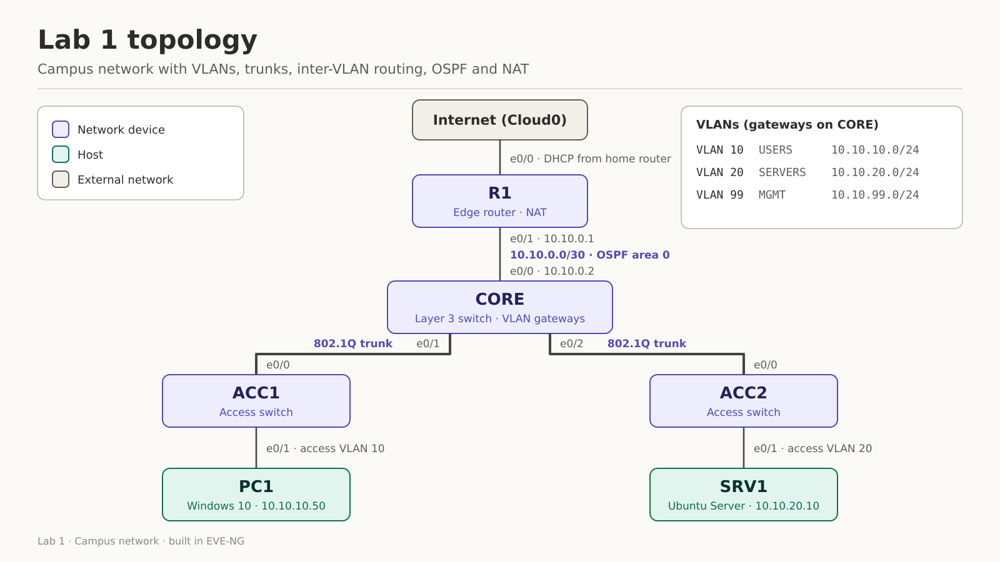

# Homelab as Code

A homelab documented as it is built: network designs, device configurations, diagrams and troubleshooting notes, kept in version control so every lab can be rebuilt from this repository.

## EVE-NG network labs

| Lab | Topic |
|---|---|
| [Lab 1: Campus network](eve-ng-labs/lab1-campus-network/) | VLANs, 802.1Q trunks, inter-VLAN routing, OSPF, NAT |

## Environment

- EVE-NG Community running as a VM in VMware Workstation
- Vendor images are licensed software and are not included in this repository
