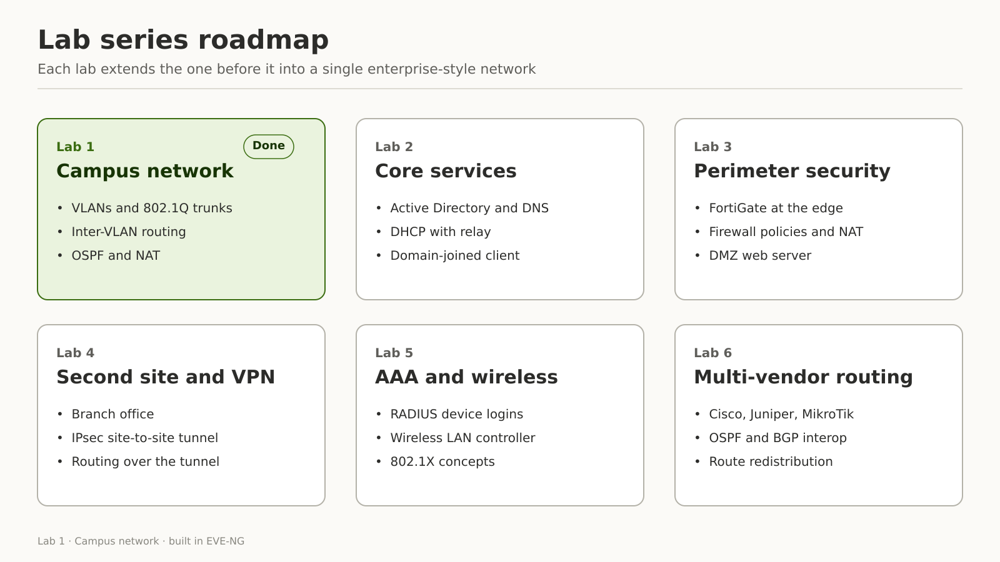

# Homelab as Code

A homelab documented as it is built: network designs, device configurations, diagrams and troubleshooting notes, kept in version control so every lab can be rebuilt from this repository.

## EVE-NG network labs

A series of labs that build on each other into a single enterprise-style network.

| Lab | Topic | Status |
|---|---|---|
| [Lab 1: Campus network](eve-ng-labs/lab1-campus-network/) | VLANs, 802.1Q trunks, inter-VLAN routing, OSPF, NAT | Complete |
| Lab 2: Core services | Active Directory, DNS, DHCP relay, domain join | Planned |
| Lab 3: Perimeter security | Edge firewall, NAT, policies, DMZ | Planned |
| Lab 4: Second site and VPN | Branch office, IPsec site-to-site tunnel | Planned |
| Lab 5: AAA and wireless | RADIUS device logins, wireless LAN controller | Planned |
| Lab 6: Multi-vendor routing | OSPF and BGP between vendors | Planned |

## Latest: Lab 1

## Environment

- EVE-NG Community running as a VM in VMware Workstation
- Vendor images are licensed software and are not included in this repository
