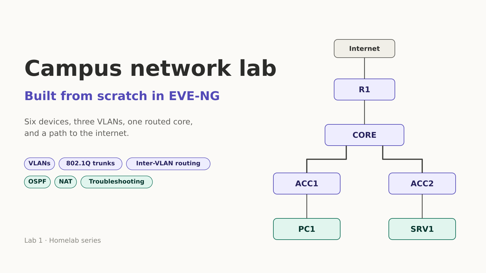
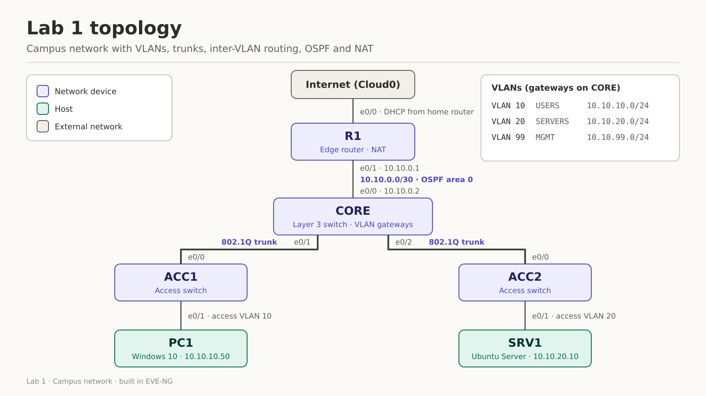
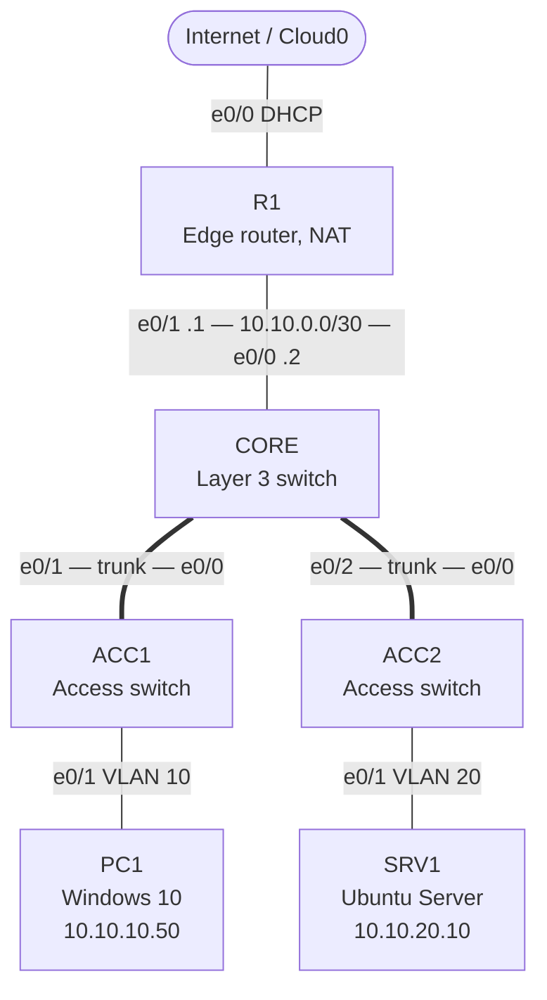
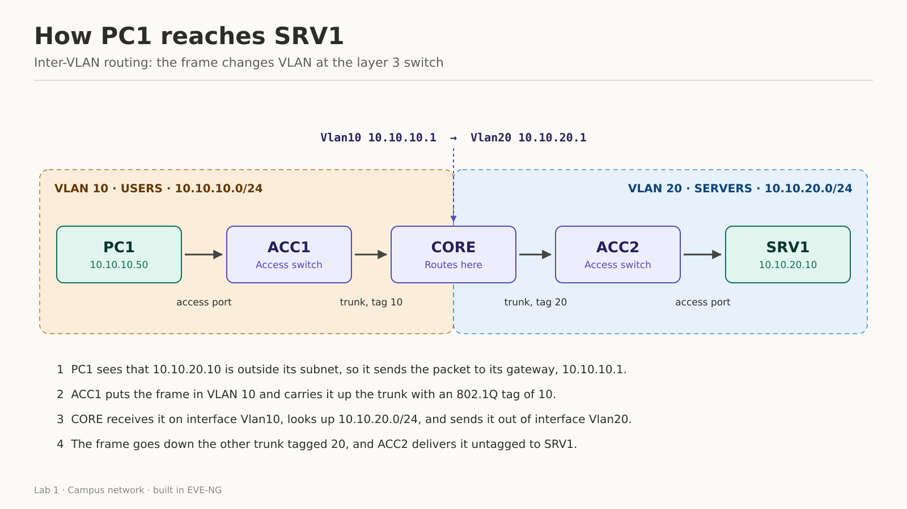
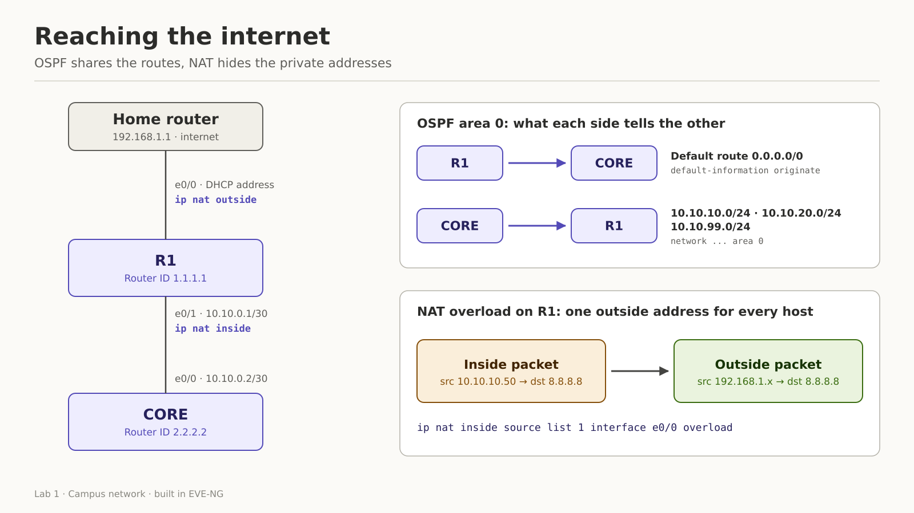
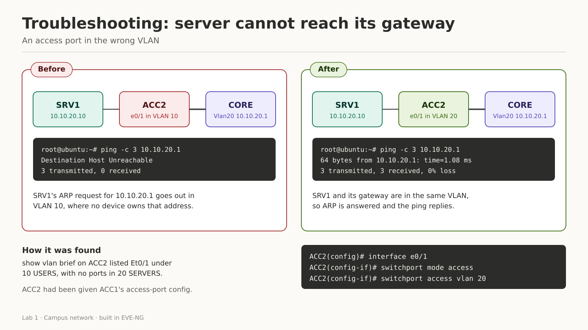
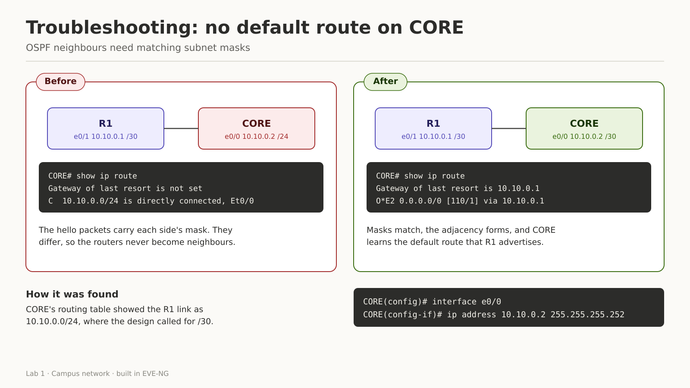

# Lab 1: Campus network in EVE-NG



A small campus network built from scratch in EVE-NG: three VLANs, 802.1Q trunks, inter-VLAN routing on a layer 3 switch, OSPF between the core and the edge router, and NAT to the internet.

## What this lab covers

| Area | What was built |
|---|---|
| Switching | VLANs 10, 20 and 99, access ports, 802.1Q trunks |
| Routing | Inter-VLAN routing on a layer 3 switch, OSPF area 0 |
| Internet access | DHCP client on the edge router, NAT overload |
| Hosts | Windows 10 client, Ubuntu Server with a static netplan config |
| Troubleshooting | Three faults found and fixed during the build |

## Topology





## Devices

| Node | Platform | Role |
|---|---|---|
| R1 | Cisco IOL L3 (15.4) | Edge router, OSPF, NAT |
| CORE | Cisco IOL L2 (15.2) | Layer 3 switch, gateway for every VLAN |
| ACC1, ACC2 | Cisco IOL L2 (15.2) | Access switches |
| PC1 | Windows 10 Pro | Client in VLAN 10 |
| SRV1 | Ubuntu Server 24.04 | Server in VLAN 20 |

## Addressing

| VLAN | Name | Subnet | Gateway (CORE) | Hosts |
|---|---|---|---|---|
| 10 | USERS | 10.10.10.0/24 | 10.10.10.1 | PC1 10.10.10.50 |
| 20 | SERVERS | 10.10.20.0/24 | 10.10.20.1 | SRV1 10.10.20.10 |
| 99 | MGMT | 10.10.99.0/24 | 10.10.99.1 | Reserved for device management |

| Link | Subnet | Addresses |
|---|---|---|
| R1 e0/1 to CORE e0/0 | 10.10.0.0/30 | R1 .1, CORE .2 |
| R1 e0/0 to Cloud0 | Home LAN | DHCP |

## How traffic moves

### Between VLANs



### Out to the internet



## Repository layout

```
.
├── README.md
├── configs/            Device configurations and the server's netplan file
├── diagrams/           SVG and PNG diagrams, plus the script that generates them
├── docs/
│   ├── build-guide.md      Step-by-step build with a check after each stage
│   └── troubleshooting.md  The faults hit during the build and how they were found
└── posts/              Write-ups for sharing the lab
```

## Build it yourself

Follow [docs/build-guide.md](docs/build-guide.md). In short:

1. Place the six nodes and the Cloud0 network, and draw every link before starting anything.
2. Create the VLANs and configure access ports and trunks on ACC1 and ACC2.
3. Configure CORE: trunks, VLAN interfaces, `ip routing`, and the routed link to R1.
4. Give PC1 and SRV1 static addresses and test across VLANs.
5. Configure R1's interfaces, then OSPF on R1 and CORE.
6. Add NAT on R1 and test internet access.

## Verification

| Test | Command | Expected |
|---|---|---|
| Trunks are up | `show interfaces trunk` on each switch | Uplinks listed as trunking |
| Ports are in the right VLAN | `show vlan brief` | PC1's port in 10, SRV1's port in 20 |
| Inter-VLAN routing | `ping 10.10.20.10` from PC1 | Replies |
| OSPF adjacency | `show ip ospf neighbor` on R1 | CORE (2.2.2.2) in FULL state |
| Default route learned | `show ip route` on CORE | `O*E2 0.0.0.0/0 via 10.10.0.1` |
| NAT | `ping 8.8.8.8` from PC1, then `show ip nat translations` on R1 | Replies and a translation entry |
| DNS | `ping google.com` from PC1 | Replies |

## Troubleshooting log

Three faults came up during the build. Each is written up in [docs/troubleshooting.md](docs/troubleshooting.md).





## Environment

- EVE-NG Community 6.2.0-4, running as a VM in VMware Workstation
- 8 vCPUs and 16 GB RAM assigned to the EVE-NG VM
- This lab uses about 8 GB of RAM with all nodes running

## Notes

- Vendor images are licensed software and are not included in this repository. Obtain them from the vendor.
- The files in `configs/` are the configurations applied in this lab. Replace them with the output of `show running-config` from your own devices if you change anything.
- The diagrams are generated by `diagrams/make_diagrams.py`, so they can be edited and rebuilt.
