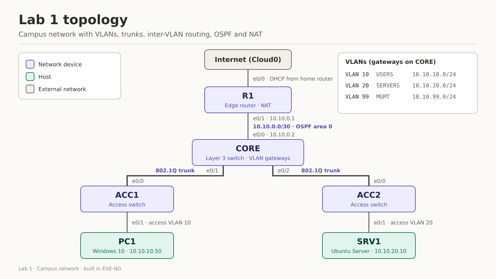
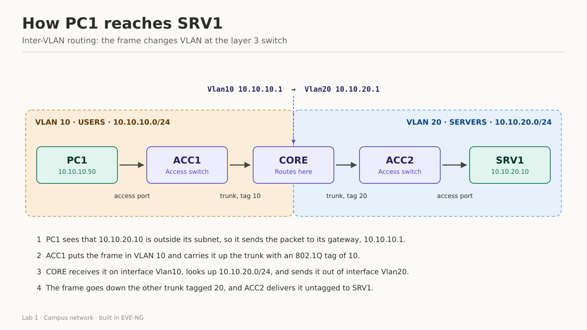
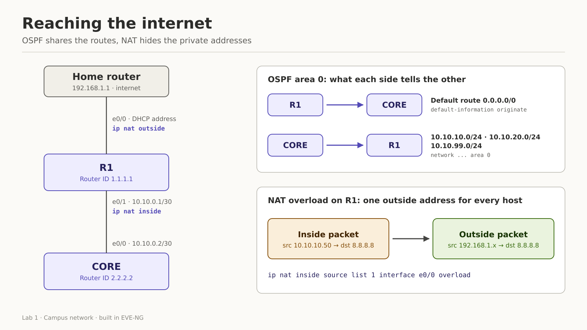

# Build guide

Each stage ends with a check. Do not move on until the check passes.



## Stage 1: place the nodes and links

Add the nodes in a new EVE-NG lab.

| Name | Template | Image | Settings |
|---|---|---|---|
| R1 | Cisco IOL | L3 image (15.4) | Defaults, router icon |
| CORE, ACC1, ACC2 | Cisco IOL | L2 image (15.2) | Defaults, switch icon |
| PC1 | Windows | Windows 10 | 4096 MB, 2 CPUs |
| SRV1 | Linux | Ubuntu Server 24.04 | 2048 MB |
| Internet | Network | Management(Cloud0) | |

Draw every link before starting any node. EVE-NG Community cannot add links to running nodes.

| From | To |
|---|---|
| Internet | R1 e0/0 |
| R1 e0/1 | CORE e0/0 |
| CORE e0/1 | ACC1 e0/0 |
| CORE e0/2 | ACC2 e0/0 |
| ACC1 e0/1 | PC1 |
| ACC2 e0/1 | SRV1 |

The router and the switches share the Cisco IOL template. The image decides what the node is: an L3 image is a router, an L2 image is a switch.

## Stage 2: access switches

Apply [configs/ACC1.cfg](../configs/ACC1.cfg) and [configs/ACC2.cfg](../configs/ACC2.cfg). The only differences are the hostname and the access VLAN: 10 on ACC1, 20 on ACC2.

On this image, `switchport trunk encapsulation dot1q` must be entered before `switchport mode trunk`.

**Check**

```
show vlan brief
show interfaces trunk
```

VLANs 10, 20 and 99 exist. `Et0/1` is in VLAN 10 on ACC1 and VLAN 20 on ACC2. `Et0/0` is trunking.

## Stage 3: core switch

Apply the switching and VLAN interface sections of [configs/CORE.cfg](../configs/CORE.cfg).

`ip routing` turns the switch into a layer 3 switch. Each `interface vlan` is the default gateway for that VLAN.

**Check**

```
show interfaces trunk
show ip interface brief
```

`Et0/1` and `Et0/2` are trunking. `Vlan10` and `Vlan20` are up/up.

## Stage 4: hosts

| Host | Address | Gateway |
|---|---|---|
| PC1 | 10.10.10.50/24 | 10.10.10.1 |
| SRV1 | 10.10.20.10/24 | 10.10.20.1 |

For SRV1, place [configs/SRV1-netplan.yaml](../configs/SRV1-netplan.yaml) in `/etc/netplan/`, then run `sudo netplan apply`. YAML is indentation-sensitive: two spaces per level, no tabs.

**Check**

From PC1:

```
ping 10.10.10.1
ping 10.10.20.10
```

Both reply. Windows blocks inbound ping by default, so test from PC1 toward SRV1.



## Stage 5: edge router and OSPF

Apply [configs/R1.cfg](../configs/R1.cfg), then the OSPF section of [configs/CORE.cfg](../configs/CORE.cfg).

- `ip address dhcp` on R1 e0/0 takes an address and a default route from the upstream network.
- `default-information originate` makes R1 advertise that default route into OSPF.
- `passive-interface` on CORE's VLAN interfaces advertises those subnets without sending OSPF hellos to hosts.

**Check**

```
R1#   show ip ospf neighbor
CORE# show ip route
```

R1 shows neighbour 2.2.2.2 in FULL state. CORE shows `O*E2 0.0.0.0/0 via 10.10.0.1`.

## Stage 6: NAT and internet access

NAT is already in R1.cfg: `ip nat outside` on e0/0, `ip nat inside` on e0/1, and the overload statement.



**Check**

From PC1 and SRV1:

```
ping 10.10.0.1
ping 8.8.8.8
ping google.com
```

On R1, `show ip nat translations` lists the inside address paired with R1's outside address.

## Save

```
write memory
```

Run it on all four network devices, then use **More actions → Export all CFGs** in EVE-NG and export the lab file.
