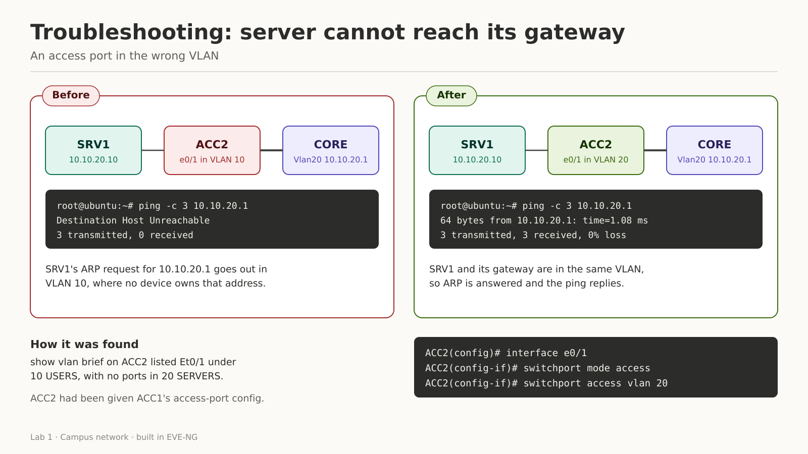
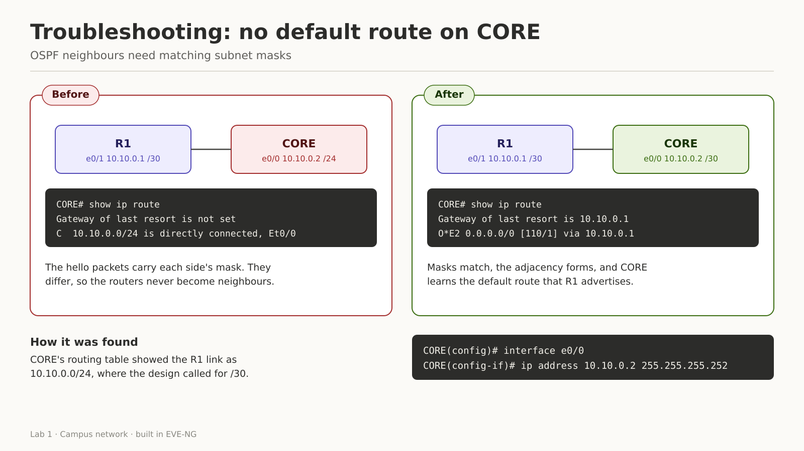

# Troubleshooting log

Faults hit while building Lab 1, in the order they appeared. The method was the same each time: find the lowest layer that is broken, and check one hop at a time.

## 1. Server cannot reach its gateway



**Symptom**

```
root@ubuntu:~# ping -c 3 10.10.20.1
From 10.10.20.10 icmp_seq=1 Destination Host Unreachable
3 packets transmitted, 0 received, +3 errors, 100% packet loss
```

"Destination Host Unreachable" reported from the server's own address means ARP for the gateway got no answer. That is a layer 2 problem, not a routing problem.

**Checks, hop by hop**

| Hop | Command | Looking for |
|---|---|---|
| Access port | `show vlan brief` on ACC2 | SRV1's port listed under VLAN 20 |
| Trunk | `show interfaces trunk` on ACC2 and CORE | VLAN 20 allowed and active |
| Gateway | `show ip interface brief` on CORE | Vlan20 up/up with 10.10.20.1 |

**Finding**

```
ACC2>show vlan brief
VLAN Name       Status    Ports
1    default    active    Et0/2, Et0/3
10   USERS      active    Et0/1
20   SERVERS    active
```

`Et0/1` was in VLAN 10 and VLAN 20 had no ports. ACC2 had been given ACC1's access-port configuration.

**Fix**

```
ACC2(config)# interface e0/1
ACC2(config-if)# switchport mode access
ACC2(config-if)# switchport access vlan 20
```

**Result**

```
root@ubuntu:~# ping -c 3 10.10.20.1
64 bytes from 10.10.20.1: icmp_seq=1 ttl=255 time=1.08 ms
3 packets transmitted, 3 received, 0% packet loss
```

## 2. No default route on CORE



**Symptom**

After OSPF was configured on both devices, CORE had no OSPF routes.

```
CORE#show ip route
Gateway of last resort is not set

C        10.10.0.0/24 is directly connected, Ethernet0/0
L        10.10.0.2/32 is directly connected, Ethernet0/0
```

**Finding**

The link to R1 was `10.10.0.0/24` on CORE. The design, and R1's side, used `/30`. OSPF hello packets carry the subnet mask, and on a broadcast link the two ends must agree before they become neighbours.

**Fix**

```
CORE(config)# interface e0/0
CORE(config-if)# ip address 10.10.0.2 255.255.255.252
```

**Result**

```
CORE#show ip route
Gateway of last resort is 10.10.0.1 to network 0.0.0.0

O*E2  0.0.0.0/0 [110/1] via 10.10.0.1, 00:01:06, Ethernet0/0
C        10.10.0.0/30 is directly connected, Ethernet0/0
```

## 3. Duplex mismatch message on R1

**Symptom**

```
%CDP-4-DUPLEX_MISMATCH: duplex mismatch discovered on Ethernet0/1 (not full duplex),
with CORE Ethernet0/0 (full duplex).
```

**Finding**

IOL router interfaces default to half duplex while the switch port runs full duplex. CDP reports the difference once a minute. Traffic still passes in the emulator, but the message clutters the console.

**Fix**

```
R1(config)# interface e0/1
R1(config-if)# duplex full
```

## 4. Trunk not listed on ACC2

**Symptom**

`show interfaces trunk` listed the uplink on ACC1 and nothing on ACC2.

**Checks**

```
show running-config interface e0/0
show interfaces e0/0 switchport
show ip interface brief
```

A trunk only appears in that output when the port is configured as a trunk and is up. The usual causes are the trunk commands landing on a different port, the encapsulation line being skipped so `switchport mode trunk` was rejected, or the link in EVE-NG being attached to another interface.

**Finding and fix**

_Record the cause you found here._

## YAML indentation on the server

`netplan apply` rejected the first version of the server's network file with "inconsistent indentation". Netplan files use two spaces per level and no tabs. The `via:` line under a route must line up with `to:`, not with the dash. The working file is in [configs/SRV1-netplan.yaml](../configs/SRV1-netplan.yaml).

## Takeaways

- Read the error for the layer it points to. "Host unreachable" from your own address is ARP failing.
- `show vlan brief` and `show interfaces trunk` answer most access-layer questions.
- When a routing protocol is silent, compare the two ends of the link: addresses, masks, area.
- Change one thing, then test again.
